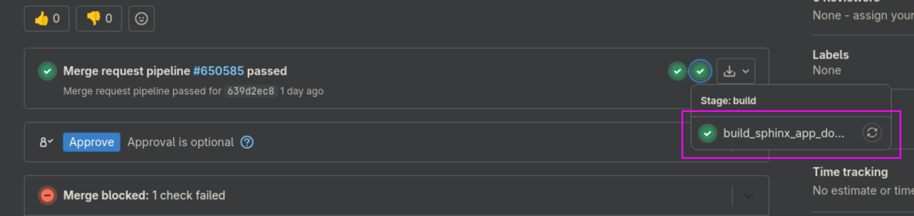

# Using this documentation

This documentation is made with Sphinx using [MyST Markdown](https://myst-parser.readthedocs.io/en/latest/index.html).

It is published to https://kde-builder.kde.org

## Preview the documentation in Merge Requests

When making changes to the documentation, and pushing your commits to gitlab, you can preview the rendered documentation using
artifacts of _build_sphinx_app_docs_ job.

Select the job, then in its page in the right pane, in the "Job artifacts" press "Browse".
Then navigate to the path `public/en/index.html` and click on it.

## Building documentation locally

You can run the `scripts/build_docs.sh` script to build documentation. There are two modes of operation:

Running the script without any arguments builds the documentation and places the output in `doc/_build/html/index.html`.

Running the script with the `--watch` flag will watch the source files for changes and rebuild the documentation as needed.
It also starts a web server on a random port, and opens the browser to show a live preview. You may need to reload the page once.
